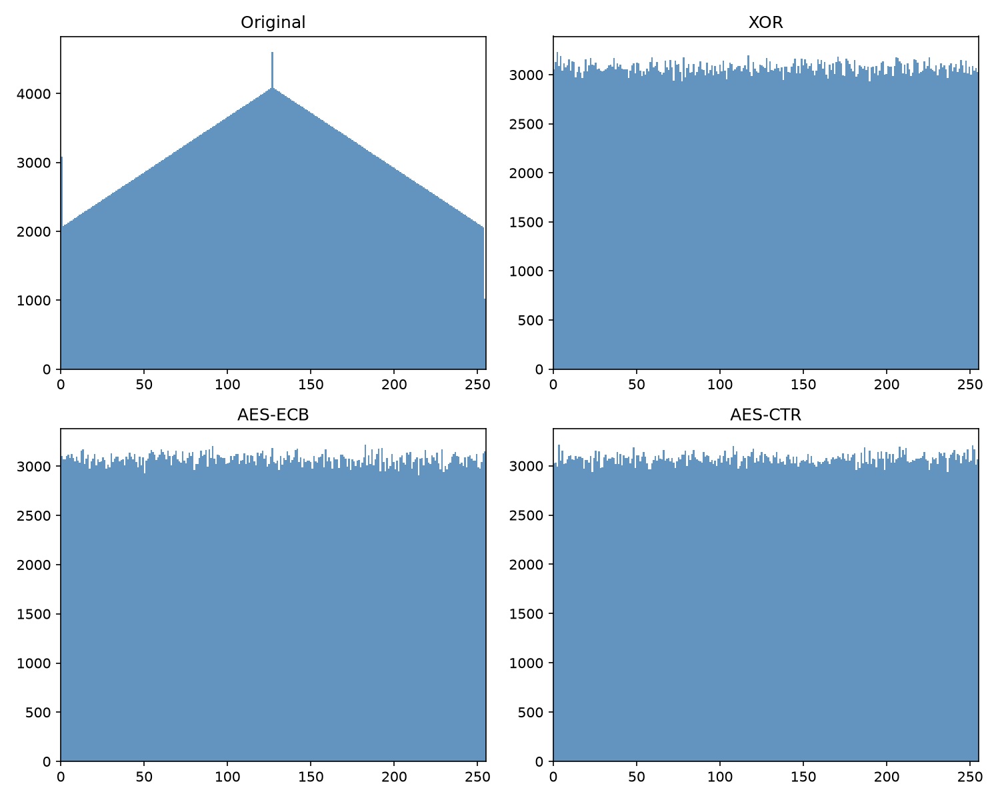
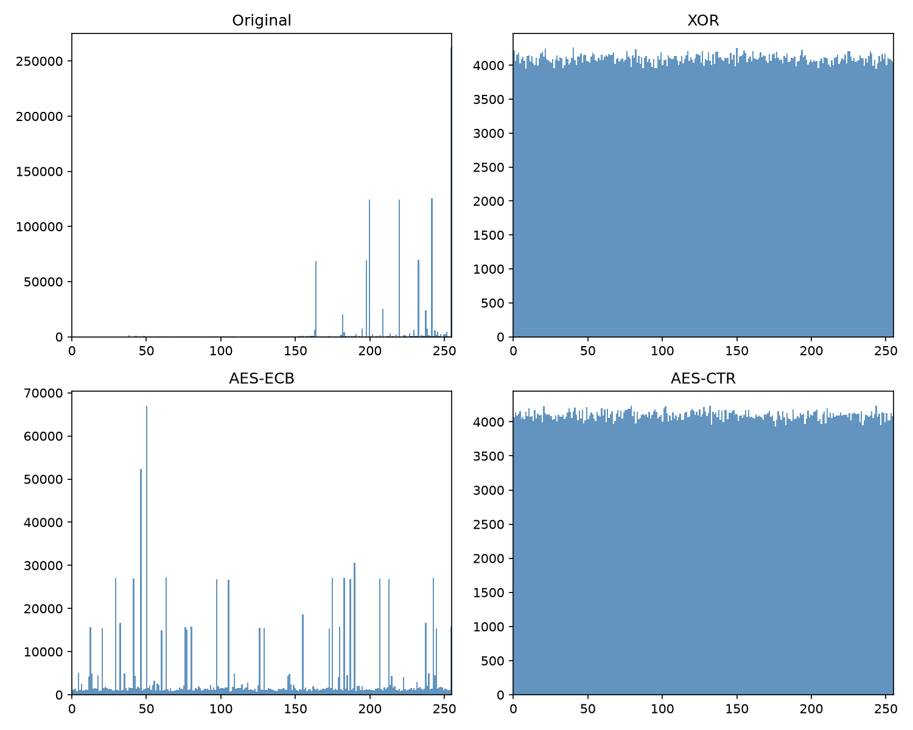

# Отчёт по лабораторной работе №1
## Шифрование изображений и статистическое сравнение методов

### 1. Постановка задачи

В работе реализованы и сравнены три метода шифрования изображений:

- потоковый шифр на основе XOR с генератором xorshift32;
- AES в режиме ECB;
- AES в режиме CTR.

Для экспериментов использованы:

- `gradient.png` — плавный градиент;
- `map.png` — собственное изображение (карта, 512×512).

Сравнивались энтропия, корреляция соседних пикселей, гистограммы, а также чувствительность к изменению ключа (NPCR, UACI).

---

### 2. Реализация

**Потоковый XOR.**  
Ключ преобразуется в seed через SHA-256. Генератор xorshift32 формирует ключевой поток. Каждый байт изображения XOR-ится с байтом потока. Шифрование и расшифрование выполняются одной и той же операцией.

**AES-ECB.**  
Ключ получается из пароля через SHA-256 (16 байт). Данные дополняются по PKCS7 и шифруются блоками 16 байт независимо.

**AES-CTR.**  
Используется тот же ключ. Для каждого шифрования генерируется nonce (8 байт), который сохраняется рядом с результатом. Режим работает как потоковый.

Обратимость проверялась сравнением массивов пикселей исходного и восстановленного изображений (`numpy.array_equal`).

---

### 3. Методика эксперимента

Основное статистическое сравнение проведено для обоих изображений.

Метрики:

- энтропия распределения байтов;
- коэффициент корреляции Пирсона по горизонтали и вертикали (5000 случайных пар пикселей);
- гистограммы значений пикселей;
- NPCR и UACI при изменении одного символа ключа (для XOR).

---

### 4. Результаты

#### 4.1. Обратимость

Для обоих изображений:

| Метод   | Восстановление |
|---------|----------------|
| XOR     | True           |
| AES-ECB | True           |
| AES-CTR | True           |

#### 4.2. Метрики для gradient.png

| Метод    | Энтропия | Corr H  | Corr V  |
|----------|----------|---------|---------|
| Original | 7.9716   | 1.0000  | 1.0000  |
| XOR      | 7.9998   | -0.0239 | -0.0268 |
| AES-ECB  | 7.9998   | -0.0116 | 0.0215  |
| AES-CTR  | 7.9998   | 0.0072  | 0.0105  |

NPCR (XOR, смена ключа): 99.6078%  
UACI (XOR, смена ключа): 33.4721%

#### 4.3. Метрики для map.png

| Метод    | Энтропия | Corr H  | Corr V  |
|----------|----------|---------|---------|
| Original | 3.9440   | 0.7166  | 0.6725  |
| XOR      | 7.9998   | -0.0084 | 0.0108  |
| AES-ECB  | 6.6716   | -0.0869 | 0.6896  |
| AES-CTR  | 7.9998   | -0.0190 | 0.0119  |

NPCR (XOR, смена ключа): 99.6085%  
UACI (XOR, смена ключа): 33.4592%

---

### 5. Анализ

На градиенте все три метода дают почти максимальную энтропию (~8) и околонулевую корреляцию. Гистограммы становятся близкими к равномерным.

На карте картина другая:

- **XOR** и **AES-CTR** полностью разрушают структуру: энтропия ≈ 8, корреляции ≈ 0, гистограмма равномерная.
- **AES-ECB** сохраняет заметную структуру. Энтропия всего 6.67, вертикальная корреляция остаётся высокой (0.69), на гистограмме видны отдельные пики.

Причина — свойство ECB: одинаковые блоки открытого текста дают одинаковые блоки шифротекста. На карте много однотонных областей, поэтому шаблоны частично сохраняются.

Чувствительность к ключу у потокового XOR высокая: NPCR ≈ 99.6%, UACI ≈ 33.5%. Это соответствует ожидаемым значениям для хорошего перемешивания.

Визуальные гистограммы согласуются с численными метриками.

---

### 6. Итоговый вывод

Эксперимент показал:

1. Потоковый XOR и AES-CTR эффективно уничтожают статистическую структуру изображения.
2. AES-ECB на изображениях с повторяющимися областями работает заметно хуже и сохраняет часть закономерностей.
3. Численные показатели (энтропия, корреляция) и гистограммы дают согласованные выводы.
4. Небольшое изменение ключа в потоковом шифре приводит к почти полному изменению шифротекста (высокий NPCR/UACI).

Для шифрования изображений предпочтительны режимы, работающие как потоковые (CTR) или полноценные режимы сцепления, а не ECB.
